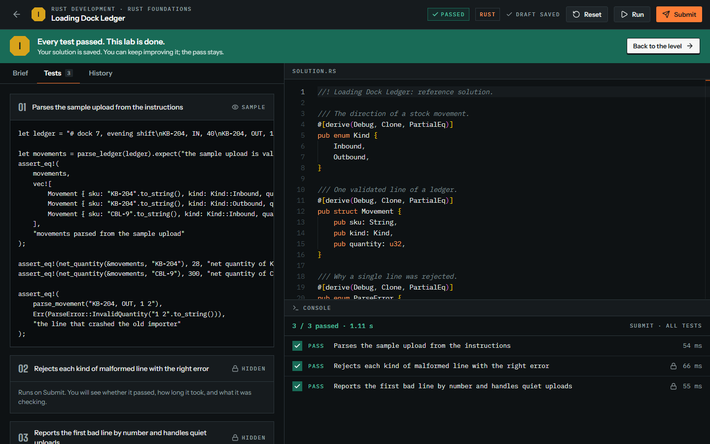
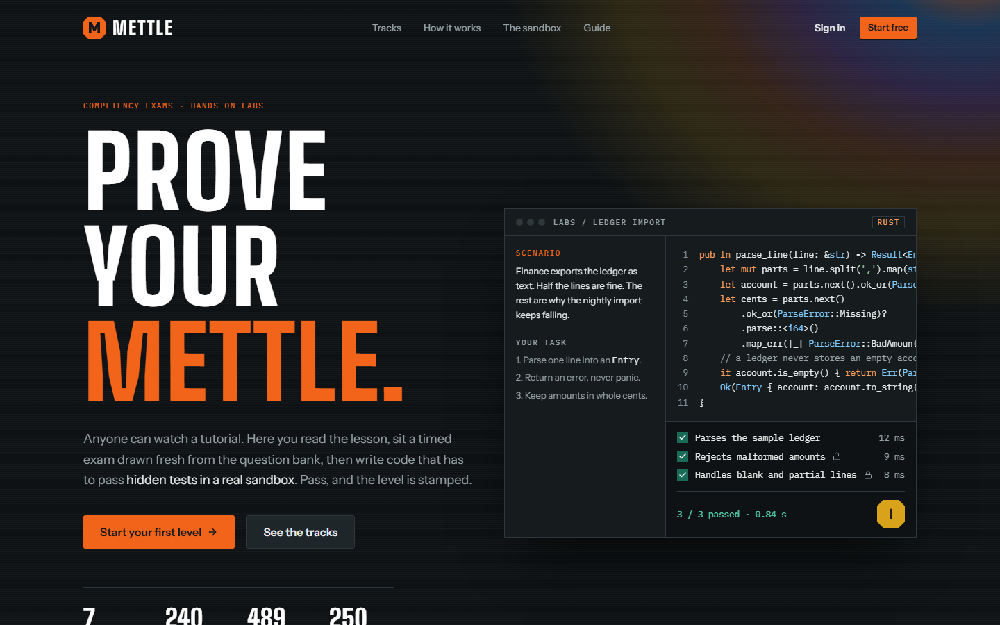
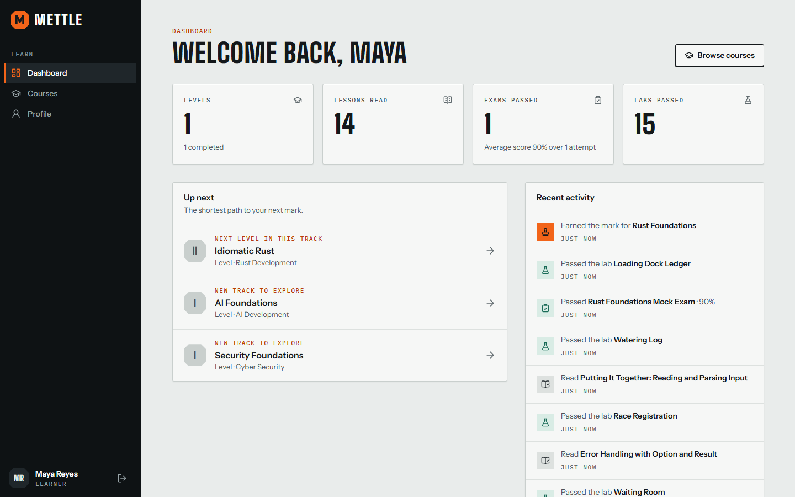
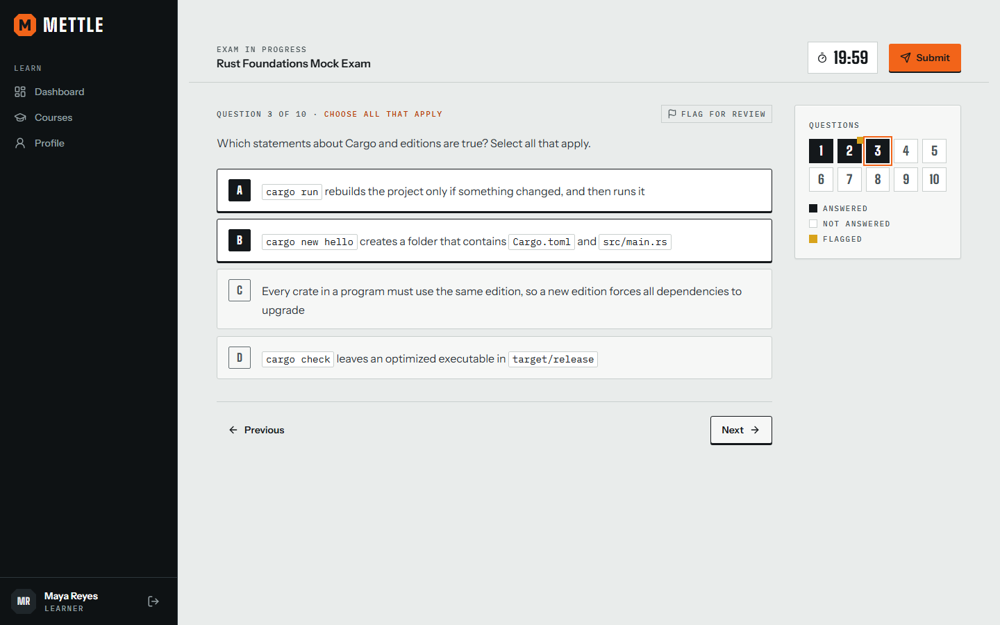
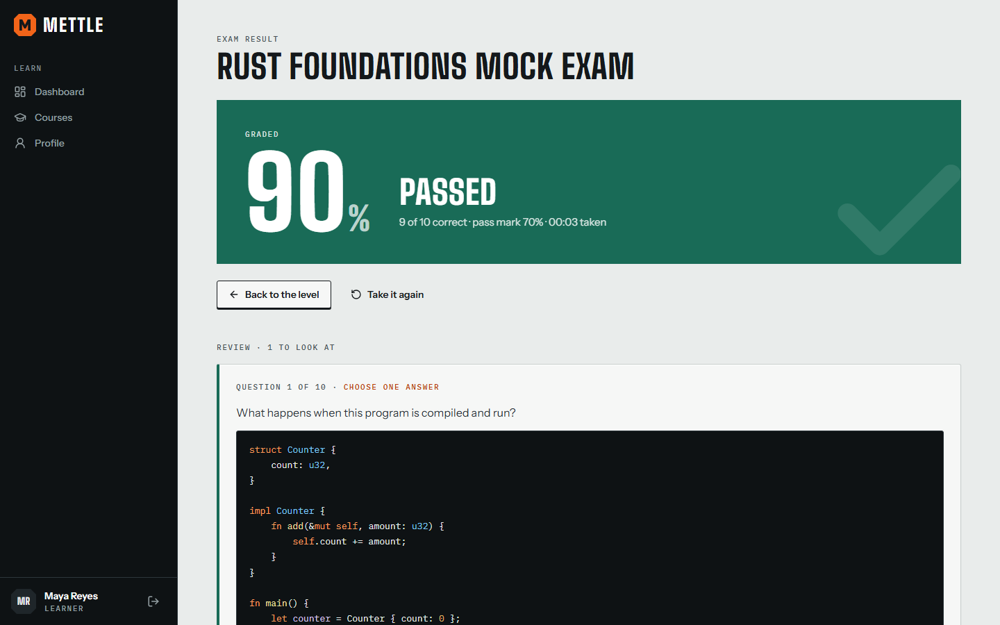
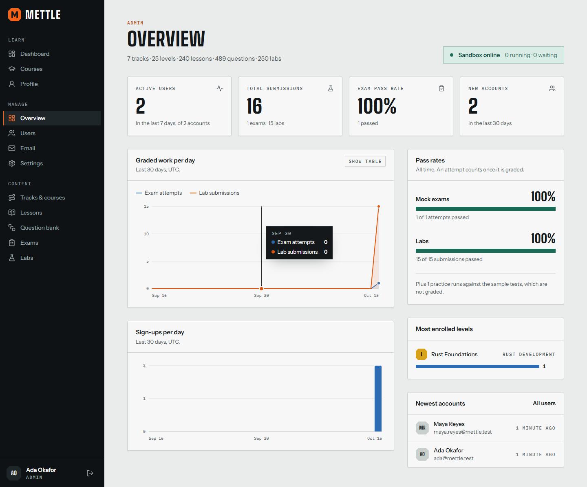
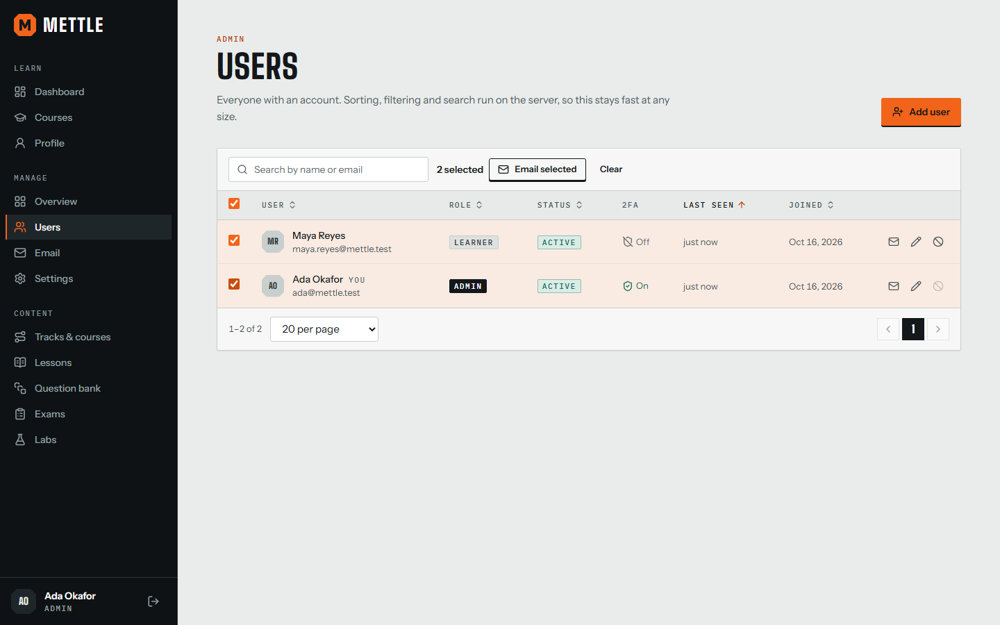

# Mettle

**Prove your mettle.** A competency exam and hands-on lab platform: learners read a lesson, sit a
timed exam generated from a question bank, then write real code that has to pass hidden tests in
a sandbox.



- **Exams that cannot be memorized.** A blueprint of rules draws a new paper from the question
  bank for every attempt, and freezes it so it can be reviewed exactly as it was sat.
- **Labs that really run.** Rust, C++ and C# are compiled, Python is executed, shell scripts are
  run against files and YAML is parsed, each in a single-use container with no network, a
  read-only filesystem and hard limits.
- **A full platform around them.** Accounts with two-factor authentication, a learner portal with
  progress and a skill tree, and an admin panel for users, email and all of the content.

| | |
| --- | --- |
|  |  |
| The public home page, with live counts from the catalog | The dashboard: what to do next, and what you did |
|  |  |
| A timed exam with a question navigator and flags | The result, with every answer explained |
|  |  |
| Metrics, pass rates and thirty days of activity | Users: server-side search, sort, filter, bulk email |

**Guides:** [User guide](docs/USER-GUIDE.md) (also in the app at `/guide`) ·
[Architecture and sandbox](docs/ARCHITECTURE.md) · [Database schema](docs/SCHEMA.md) ·
[Curriculum](docs/CURRICULUM.md) · [Changelog](CHANGELOG.md)

## Quick start

You need Docker with Compose, and Node.js 22 or newer (only to generate the secrets).

```bash
git clone https://github.com/kizzbonez/mettle.git
cd mettle
npm run init:env              # writes .env with random secrets
docker compose up -d --build  # builds everything, including the sandbox images
docker compose logs api       # shows the one-time setup token
```

Open <http://localhost:4310>. A new install has no accounts, so the site opens a five-step setup:
paste the token from the log, create the administrator, scan the two-factor QR code, name the
site, and save your recovery codes. The curriculum is loaded automatically on first start.

**Upgrading.** `git pull`, then `docker compose up -d --build`. The database is migrated, new
subjects are added, and revised tracks are updated in place; accounts, progress and anything you
wrote yourself are kept.

Mail sent by the site (welcome messages, password resets) is caught by a local inbox at
<http://localhost:4325> until you configure a real SMTP server.

The first build downloads the Rust toolchain image and takes a few minutes. Later starts are
quick.

## What is in it

**For learners**

- A public home page listing the tracks, and a public user guide.
- Sign-up with a password-strength meter and a confirm-password field; sign-in; password reset by
  emailed single-use link; optional two-factor authentication with recovery codes.
- Dashboard with progress, recent activity and recommended next steps.
- Courses: every track and level, with enrollment on first visit and per-level progress.
- Lessons in Markdown with highlighted code, objectives and previous/next navigation.
- Mock exams with a server-enforced timer, answers saved as you go, flagging, and a full review
  with explanations afterwards.
- Practice labs: a small lab attached to a lesson, offered at the end of it and listed under it
  on the level page.
- Labs in a resizable split-screen workspace: brief, tests, files and history on the left; the
  Monaco editor and a test console on the right. *Run* tries the sample test, *Submit* runs them
  all. Drafts are saved automatically.
- Profile: skill tree, exam history, password, two-factor, and signed-in devices.

**For instructors and administrators**

- First-run setup wizard, gated by a one-time token from the server log.
- Overview: active users, total submissions, pass rates, 30-day charts, sandbox status.
- Users: server-side paging, sorting, filtering and search; edit roles, suspend and reinstate,
  create accounts, and email one or many users. An email log and an audit log.
- Content management for tracks and courses, lessons (Markdown with live preview), the question
  bank (with bulk import), exams (fixed papers or rule-based blueprints) and labs (with a
  "verify in sandbox" check before publishing).

**The curriculum that ships with it**

| Track | Basic | Medium | Advanced | Professional |
| --- | --- | --- | --- | --- |
| **Rust Development** | Rust Foundations | Idiomatic Rust | Concurrency and Systems | Production Rust |
| **C# Development** | C# Foundations | Types, Generics and LINQ | Async and Advanced Language Features | Production .NET |
| **Linux Command Line** | Shell Foundations | Text and Automation | Robust Shell Scripting | Systems Administration |
| **Python Development** | Python Foundations | Idiomatic Python | The Data Model and Concurrency | Production Python |
| **Data Analysis with NumPy and pandas** | NumPy Foundations | pandas Foundations | Analysing and Reshaping Data | Production Data Work |
| **AI Development** | AI Foundations | Building with LLMs | Models Under the Hood | Production AI Systems |
| **Cyber Security** | Security Foundations | in development | in development | in development |

240 lessons, 489 exam questions with explanations and 250 labs. Every lab is verified in the
sandbox: its reference solution passes, its starter code does not. The whole curriculum is
plain files under [`content/`](content/README.md) and is documented in
[docs/CURRICULUM.md](docs/CURRICULUM.md).

**Rust Development is a full course**: 46 lessons that start from installing Rust and a first
program and go on to concurrency, async, unsafe code and release engineering. It was written
from the official documentation (The Rust Programming Language for the 2024 edition, the
standard library reference, the Rustonomicon, the Cargo Book and others); each lesson has
worked examples that were compiled and run, common mistakes, practice with answers, and links
to its sources. Its four question banks hold 96 questions, and every exam attempt draws ten.
Every one of its 46 lessons ends with a short **practice lab**, so each idea is tried in the
editor straight after it is read.
**C# Development is a full course in the same format**: 45 lessons on C# 14 and .NET 10, from
installing .NET and a first program to async code, concurrency, spans, dependency injection
and shipping, written from Microsoft Learn with every example compiled and run. Its question
banks hold 93 questions, each level ends with a lab, and every one of its 45 lessons ends with a
practice lab.
**Linux Command Line is the third full course**: 45 lessons on Bash and the GNU tools that start
from what Linux and the shell are and a first command, and go on to text processing with grep,
sed and awk, robust scripts with strict mode, traps and ShellCheck, and the system
administration topics of LPIC-1 (users, systemd, logs, scheduling, disks, networking, SSH and
security). It was written from the man pages, the GNU and Bash manuals, the Bash wiki and the
LPIC-1 objectives. Its question banks hold 93 questions, each level ends with a lab, and every
lesson ends with a practice lab that runs real Bash.
**Python Development is the fourth**: 47 lessons on Python 3.15, planned against the Python
Institute's PCEP and PCAP syllabi. It starts from what Python is, installing it and a first
program, and goes on to modules and imports, packages and virtual environments, classes,
files, generators, decorators, the data model, type hints, threads, processes and asyncio,
then packaging, testing, logging, command-line programs, performance, memory and security. It
was written from the Python documentation and the PEPs, with every example run on Python 3.15.
Its question banks hold 93 questions, each level ends with a lab, and every lesson ends with a
practice lab.
**Data Analysis with NumPy and pandas is the fifth**: 42 lessons on NumPy 2.5 and pandas 3 for
people who know Python. It starts from what an array is and why it beats a list, and goes on
to indexing, broadcasting and aggregation, then pandas from the first DataFrame to missing
data, copy-on-write, grouping, joins, reshaping, text, time zones and time series, and ends
with validation, testing, performance, memory, Parquet and reproducible pipelines. It was
written from the NumPy and pandas documentation, with every example run in the sandbox. Its
question banks hold 89 questions, and its labs, one per level and one per lesson, run NumPy and
pandas on real data files.

AI Development and Cyber Security are still in the original short format (three lessons a
level) and are next to be expanded.

## How it is built

```
browser ──► web (Next.js) ──► api (Fastify) ──► PostgreSQL
                                   │
                                   └──► runner ──► Docker Engine ──► single-use sandbox
```

| Part | Technology |
| --- | --- |
| Web | Next.js 16 (App Router), React 19, Tailwind CSS 4, Lucide, Monaco |
| API | Node.js 24, Fastify 5, Zod, Drizzle ORM |
| Database | PostgreSQL 17, 26 tables, generated SQL migrations |
| Runner | A small Fastify service with its own minimal Docker client |
| Auth | bcrypt, JWT access tokens plus revocable sessions, TOTP |

Only the web app publishes a port, and only on `127.0.0.1`. The database and the runner sit on
internal Docker networks with no route to the internet.

### The sandbox, briefly

Every submission gets a new container that is destroyed afterwards.

| Control | Setting |
| --- | --- |
| Network | none |
| Filesystem | read-only root; two 64 MB scratch areas |
| User | unprivileged, every capability dropped, `no-new-privileges` (the runner that starts sandboxes is not root either) |
| Limits | memory (no swap), 1 CPU, 64 to 128 processes, 64 KB of captured output |
| Time | every command under `timeout -s KILL`; a reaper removes leftovers |

A test passes only if its process exits 0, in time, **and** the harness printed a per-run secret
after the test body returned, so code that calls `exit(0)` early does not pass. Eighteen
integration tests start real containers to check these claims (no network, no capabilities,
fork bomb, memory hog, full disk, infinite loop, output flood).

Containers share the host kernel. For a public deployment, set `SANDBOX_RUNTIME=runsc` (gVisor)
or give the runner its own machine. [docs/ARCHITECTURE.md](docs/ARCHITECTURE.md) covers the
design and the risks that remain.

## Configuration

`.env` (created by `npm run init:env`; see [`.env.example`](.env.example)):

| Variable | Purpose |
| --- | --- |
| `PUBLIC_ORIGIN` | The address people use. Links in emails use it, and an `https://` origin makes cookies `Secure`. |
| `WEB_PORT`, `MAILPIT_PORT` | Host ports, bound to `127.0.0.1`. |
| `POSTGRES_PASSWORD`, `JWT_SECRET`, `DATA_KEY`, `RUNNER_TOKEN` | Generated secrets. `DATA_KEY` encrypts two-factor secrets at rest. |
| `SMTP_HOST`, `SMTP_PORT`, `SMTP_SECURE`, `SMTP_USER`, `SMTP_PASS`, `MAIL_FROM` | Where to send mail. Defaults to the bundled inbox. |
| `DOCKER_GID` | Group that owns the Docker socket. The runner is not root and reaches the socket through this group. `0` for Docker Desktop; on Linux, `stat -c %g /var/run/docker.sock`. |
| `RUNNER_MAX_CONCURRENCY` | Sandboxes that may run at once (default 2). |
| `SANDBOX_RUNTIME` | OCI runtime for sandboxes, for example `runsc`. |
| `SEED_CONTENT` | Keep the database up to date with `content/` at every start: add new subjects, update revised tracks in place (default `true`). |
| `SETUP_TOKEN` | Fix the first-run token instead of reading it from the log. |

**Putting it on the internet.** Serve it through a reverse proxy or tunnel that terminates HTTPS,
set `PUBLIC_ORIGIN` to the public `https://` address, and point `SMTP_*` at a real mail server.
The API takes the client address from `X-Forwarded-For` only when the request comes from a
private-network peer, so per-address rate limits depend on that proxy reporting the real client
address (Cloudflare and nginx's `$proxy_add_x_forwarded_for` both do). Do not publish the web
port directly: without a proxy in front, a client can claim any address. Account lockout and the
reset-email throttle are per account and hold either way.

## Development

```bash
npm install
npm run init:env
npm run dev:services   # database, runner and mailbox in Docker, on loopback ports
npm run dev:api        # API with reload, on 127.0.0.1:4311
npm run dev:web        # web app with reload, on 127.0.0.1:4310
npm run seed:demo      # optional: fifty demo learners with a month of activity
```

| Command | What it checks |
| --- | --- |
| `npm run lint` | ESLint, including the size budgets (200 lines per file, 40 per function, 80 per component) |
| `npm run typecheck` | TypeScript in every workspace |
| `npm test` | Unit tests |
| `npm run test:api` | The API against a real PostgreSQL, the mailbox and the sandbox runner |
| `npm run test:sandbox` | The runner against real containers, including the isolation tests |
| `npm run content:verify` | Every content file, and every lab run in the sandbox |
| `npm run content:try -- rust/basic attempt.rs` | Any attempt against one lab, to check that a wrong answer is caught |
| `npm run e2e` | A real browser walks the whole product, from setup to the admin panel |
| `npm run screenshots` | The same tour, writing the screenshots used here and in the guide |

```
apps/web       Next.js app: design system, public site, learner portal, admin panel
apps/api       Fastify API, Drizzle schema and migrations, content seeder
apps/runner    sandbox orchestrator
packages/shared types shared by all three
content/       the curriculum as Markdown, YAML and real source files
sandbox/       Dockerfiles for the sandbox images: Rust, Python, Bash, C++, C#, YAML
e2e/           the browser tour
docs/          architecture, schema, curriculum, user guide
```

Adding a subject needs no code: create it in the admin panel, or add a folder under
`content/tracks/` ([format](content/README.md)). Adding a lab language is one harness file, one
image and one registry entry.

## Known limits

- Lab jobs are queued in the API process. A restart fails jobs that were in flight (the learner
  is told to submit again). Use a durable queue before running more than one API instance.
- Labs are run-and-check, not an interactive terminal session. The Linux course's
  administration labs work on captured command output and configuration files, because the
  sandbox has no root, no systemd and no network.
- Hidden tests run in the same sandbox as the code they test, so a determined learner can
  inspect the test process. Lab results alone should not gate a high-stakes certificate.
- The sandbox can run C++ and YAML labs, and labs in those languages can be written in the
  admin panel, but no track that uses them ships yet.
- An upgrade that revises a shipped track replaces that track's shipped lessons, questions and
  labs, including any edits a site made to them. Content a site created itself is kept.
- The content editors do not warn before you leave a form with unsaved changes.
- Question categories can be created through the API (`POST /api/v1/admin/categories`) and
  chosen in the question bank, but there is no screen for creating them yet.

## Versioning and license

Releases follow [Semantic Versioning](https://semver.org); each has an annotated tag and an entry
in the [changelog](CHANGELOG.md). Released under the [MIT License](LICENSE).
