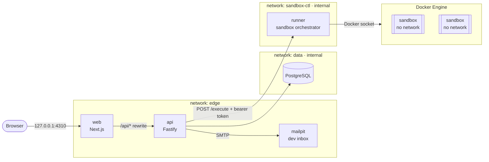
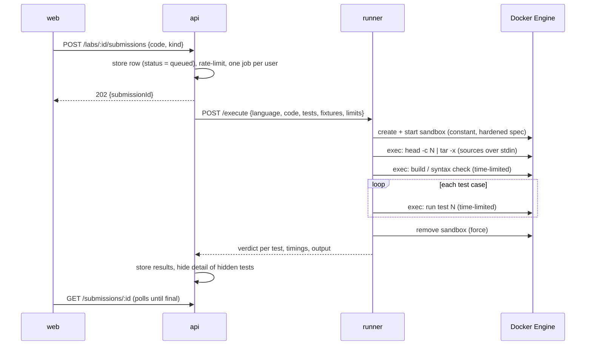

# Architecture

Mettle is four services and a database. Each service does one job, and the one that runs
untrusted code is kept as far from everything else as a single host allows.



| Service  | What it does                                                        | Networks              | Published port          |
| -------- | ------------------------------------------------------------------- | --------------------- | ----------------------- |
| `web`    | Next.js App Router UI. Proxies `/api/*` to the API.                 | edge                  | `127.0.0.1:4310`        |
| `api`    | Fastify REST API: auth, catalog, exam engine, lab jobs, admin.      | edge, data, sandbox-ctl | none                  |
| `db`     | PostgreSQL 17. Schema managed by Drizzle migrations.                | data (internal)       | none                    |
| `runner` | Turns a submission into a sandbox container and a verdict.          | sandbox-ctl (internal) | none                   |
| `mailpit`| Catches outgoing mail in development.                               | edge                  | `127.0.0.1:4325`        |

`data` and `sandbox-ctl` are Docker *internal* networks: containers on them have no route to
the internet. The database can only be reached by the API, and the runner can only be reached
by the API.

## Request path and authentication

The browser only ever talks to the web origin. Next.js rewrites `/api/*` to the API, so
cookies are first-party and there is no CORS surface.

- **Passwords** are hashed with bcrypt (cost 12).
- **Sign-in** issues two cookies, both `HttpOnly` and `SameSite=Lax`:
  a 15-minute **JWT access token** (HS256, carries user id, role and session id) and an opaque
  30-day **refresh token** whose SHA-256 hash is stored in `sessions`.
- Every authenticated request verifies the JWT **and** checks that its session row is not
  revoked and its user is not banned. Revoking a session or banning a user therefore takes
  effect on the next request, not when the token expires.
- **Two-factor** (TOTP, RFC 6238) with single-use recovery codes. The TOTP secret is encrypted
  at rest with AES-256-GCM. Administrators must enroll before they can use the admin panel.
- **Lockout**: repeated failed sign-ins lock the account for a growing interval.
- **CSRF**: state-changing requests must carry an `X-Mettle-Request` header. A cross-site form
  cannot set it, and a cross-origin `fetch` that tries triggers a preflight the API refuses.
- **Rate limits**: a global per-IP limit, tighter limits on sign-in, registration and password
  reset, and a per-user limit on lab submissions.
- **First run**: a new install has no users. The API prints a one-time setup token to its log;
  the setup wizard exchanges it for the first administrator account.

## The web app

- **Rendering.** Public pages (home, guide, sign-in) are rendered on the server and read public
  data straight from the API. Signed-in pages are shells that load their data in the browser
  through `/api`, so no page ever renders another person's data on the server by mistake.
- **Route protection.** `proxy.ts` sends a visitor without a session marker cookie to sign-in
  and brings them back afterwards. That is a convenience, not the control: the API authorizes
  every request, and the page shows nothing it was not given.
- **Content Security Policy.** Each response carries a new nonce; scripts run only with that
  nonce or when loaded by a script that has it (`strict-dynamic`). There are no third-party
  origins: fonts are bundled at build time and the Monaco editor is copied into the app's own
  static files. `frame-ancestors 'none'` forbids embedding.
- **Markdown** from lessons, questions and labs is rendered without raw HTML, so content written
  by an instructor cannot inject markup or script into a learner's page.
- **After sign-in** a `next` parameter is honored only when it is a plain path on this site.

## Secure code execution

This is the part of the system that is attacked by design: any signed-in learner can submit
arbitrary Rust, C++, C#, Python or shell code and the platform must run it.

### Lifecycle of a submission



The API answers `202` straight away and the page polls, so a slow compile never holds an
HTTP request open behind a proxy.

### The sandbox container

Every submission gets a **new container that is destroyed afterwards**. Its specification is
built from constants in [`apps/runner/src/sandbox/spec.ts`](../apps/runner/src/sandbox/spec.ts);
no field of it is derived from the request.

| Control                       | Setting                                                         | What it stops                                   |
| ----------------------------- | --------------------------------------------------------------- | ----------------------------------------------- |
| Network                       | `NetworkMode: none`                                             | Exfiltration, scanning, downloading tools       |
| Root filesystem               | Read-only                                                       | Persisting anything, tampering with the image   |
| Writable space                | Two tmpfs, 64 MB each (`/work` exec, `/tmp` noexec)             | Filling the host disk                           |
| User                          | uid/gid 10001, not root                                         | Root-only kernel attack surface                 |
| Capabilities                  | `CapDrop: ALL`                                                  | Mounting, raw sockets, ptrace of other users…   |
| Privilege escalation          | `no-new-privileges`                                             | setuid binaries                                 |
| System calls                  | Docker's default seccomp profile (and AppArmor where available) | Dangerous syscalls (`mount`, `keyctl`, `bpf`…)  |
| Memory                        | cgroup limit, swap disabled                                     | Exhausting host memory                          |
| CPU                           | 1 CPU                                                           | Starving other sandboxes                        |
| Processes                     | `PidsLimit` 64–128                                              | Fork bombs                                      |
| Time                          | `timeout -s KILL` around every command, plus a runner deadline  | Infinite loops, sleeping forever                |
| Lifetime                      | PID 1 is `sleep <budget>`; a reaper removes stale sandboxes     | Orphans if the runner crashes mid-run           |
| Output                        | 64 KB captured per stream, the rest discarded                   | Exhausting runner memory                        |
| Runtime (optional)            | `SANDBOX_RUNTIME=runsc` switches every sandbox to gVisor        | Kernel exploits that get past the above         |

All of these are checked by tests that run real containers
([`execute.integration.test.ts`](../apps/runner/src/execute.integration.test.ts)): no network,
read-only root, zero effective capabilities, a contained fork bomb, an out-of-memory kill, a
full scratch disk, a killed infinite loop and a 20 MB output flood.

### The runner

The runner is the only component that can talk to the Docker Engine, which makes it the most
sensitive process in the system. It is hardened accordingly:

- **No public surface.** It publishes no port and sits on an internal network. Its one
  endpoint requires a bearer token that only the API has.
- **Small.** It uses a ~100-line Docker client written for this project
  ([`docker/http.ts`](../apps/runner/src/docker/http.ts)) instead of a general SDK, and ships
  as a single bundled file with no `node_modules`.
- **Confined.** It does not run as root. It is an unprivileged user that reaches the socket
  through one supplementary group (`DOCKER_GID`), in a container with a read-only filesystem,
  no capabilities and `no-new-privileges`.
- **Request data never becomes configuration.** Learner code and test bodies travel only as
  file *contents* inside a tar stream. File names are generated by the runner; fixture paths
  are validated against a strict pattern and must live under `data/`.
- **Bounded.** A gate limits concurrent sandboxes (`RUNNER_MAX_CONCURRENCY`) and the queue
  behind it; past that the runner answers `503` rather than buffering work.

### Test harness

A lab has test cases; each is a snippet in the lab's language. The runner wraps the snippets
in a harness, so authors write assertions and nothing else.

| Language | Learner file  | Test case becomes                         | Build step                    | Runs as             |
| -------- | ------------- | ----------------------------------------- | ----------------------------- | ------------------- |
| Rust     | `solution.rs` | a function in a generated `main.rs`       | `rustc` (once per submission) | `./lab case_N`      |
| Python   | `solution.py` | a script that does `from solution import *` | `python -m py_compile`      | `python case_N.py`  |
| Bash     | `solution.sh` | a script with `assert_eq` / `fail` helpers | `bash -n`                    | `bash case_N.sh`    |
| C++      | `solution.cpp` | a function in a generated `main.cpp` that includes the learner's file | `g++ -std=c++20` with the address and undefined-behaviour sanitizers | `./lab case_N` |
| C#       | `solution.cs` | an async method in a generated `tests.cs` | the C# compiler, called directly (no MSBuild, no NuGet) | `dotnet lab.dll case_N` |
| YAML     | `solution.yaml` | a Python script with the parsed file in scope | a strict parse: invalid YAML or a repeated key stops the run | `python case_N.py` |
| TypeScript | `solution.ts` | a module that imports the learner's exports, with the helpers imported for it | `tsc` (TypeScript 7) strict on the learner's file, then on each test alone; the test sources are then deleted | `node lab_run.mjs out/case_N.js` |
| Go | `solution.go` | a `_test.go` file in the learner's package, its `func Test` renamed `TestCaseN` | `go test -race -c` (vet included) against a read-only cache of the compiled standard library, and `go build -race` when the file is a program; the test sources are then deleted | `./lab.test -test.run=^TestCaseN$` |

C++ labs are built with sanitizers on purpose: a use-after-free, an out-of-bounds access, a leak
or a signed overflow ends the test with a report instead of passing by luck. A YAML lab has no
program to run, so its tests are Python scripts that check what the learner's file means.
TypeScript tests are type-checked one by one, so a test can check the learner's types: a
`@ts-expect-error` line that the learner's types no longer need fails that test alone.
Go labs are built with the race detector on purpose, as C++ labs are built with sanitizers: a
data race fails the test even when every check passed.

When a compiled submission does not fit its tests (a missing function, a wrong parameter type),
the compiler quotes the offending line of the test. Those excerpts are removed before the
learner sees the output, so a hidden test stays hidden; messages about the learner's own file
are untouched.

Each test runs as **its own process with its own time limit**, so one failing or hanging test
does not hide the result of the others, and timings are per test.

**Verdict.** A test passes only if the process exits `0`, inside its time limit, *and* the
harness printed a random per-run nonce after the test body returned. The exit code alone is
not trusted: code under test can call `exit(0)` before any assertion runs.

**Hidden tests.** *Run* executes only the visible sample tests and shows their full output.
*Submit* executes every test. For a hidden test the learner sees its name, pass or fail, the
time it took and the failure message, but never the test's source or its stdout.

### Residual risk, stated plainly

- Containers share the host kernel. The controls above remove most of its attack surface, but
  a kernel vulnerability reachable through the default seccomp profile could still be used to
  escape. For a public deployment, set `SANDBOX_RUNTIME=runsc` (gVisor), or run the runner and
  its Docker Engine on a separate machine or VM from the database.
- Access to the Docker socket is equivalent to root on that Docker host. This is why the runner
  is isolated, tiny and never exposed, and why it should own a dedicated Docker Engine in
  production.
- Hidden tests run in the same sandbox as the code they test. A determined learner can write
  code that inspects the test process instead of solving the lab. That is cheating at an
  exercise, not a breach, but it means lab results alone should not gate a high-stakes
  certificate.

## Exam engine

- Questions live in one **bank**, tagged with a track, a category, a difficulty and free-form
  tags. No question belongs to an exam.
- An exam is either **fixed** (a pinned list in `exam_questions`) or **dynamic**: a list of
  **rules** in `exam_rules`, each meaning "take *n* published questions matching this track /
  category / difficulty / tag".
- Starting an attempt samples the questions, shuffles the options, and stores exactly what was
  dealt in `attempt_questions`. Two learners, or two attempts by one learner, get different
  papers from the same blueprint, and a finished attempt can always be reviewed as it was sat.
- Answers are saved as the learner goes. The deadline is enforced on the server; an attempt
  that runs out of time is graded with whatever was saved.
- Correct answers and explanations are never sent to the browser before the attempt is
  submitted.

## Modularity

- **A new subject** is a row in `tracks` with courses under it. It can be created in the admin
  panel or shipped as files under `content/tracks/<slug>/` and loaded by the seeder. No code
  changes. At every start the site adds shipped subjects it has never been given, and updates in
  place any track whose `revision` was raised, matching lessons, questions and labs by slug and
  key so learners keep their progress. A shipped track that a site deleted stays deleted.
- **A new lab language** is one harness file in `apps/runner/src/languages/`, one image under
  `sandbox/`, and one entry in the language registry.
- **Code layout.** Feature-sliced: each feature folder owns its routes, its logic and its
  tests. Files stay under 200 lines and functions under 40 (80 for React components); ESLint
  enforces both.

```
apps/
  web/      Next.js app: public site, learner portal, admin panel
  api/      Fastify API, Drizzle schema and migrations
  runner/   sandbox orchestrator
packages/
  shared/   types shared by all three
content/    the curriculum, as Markdown, YAML and real source files
sandbox/    Dockerfiles for the sandbox images
docs/       this document, the schema, the curriculum, the user guide
```
