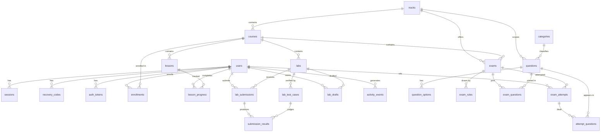

# Database schema

PostgreSQL 17, 26 tables. The schema is defined in TypeScript with Drizzle
([`apps/api/src/db/schema/`](../apps/api/src/db/schema)) and the SQL that creates it is
generated from that definition: [`apps/api/migrations/0000_init.sql`](../apps/api/migrations/0000_init.sql)
is the authoritative DDL. The API applies pending migrations when it starts.

## What the schema has to support

| Requirement                         | How                                                                                           |
| ----------------------------------- | --------------------------------------------------------------------------------------------- |
| Add a subject without a code change | A subject is a row in `tracks`. Courses, lessons, exams and labs hang off it by foreign key.   |
| Dynamic exam generation             | Questions live in a bank, not in exams. `exam_rules` describes what to draw; `attempt_questions` records what one attempt was dealt. |
| Thousands of categorized questions  | `questions` is indexed on the columns the generator filters by (`status, track_id, difficulty`), on `category_id`, and with a GIN index on `tags`. |
| User roles                          | `users.role` is an enum: `learner`, `instructor`, `admin`.                                     |
| Lab tracking                        | Every Run and Submit is a row in `lab_submissions` with one `submission_results` row per test. |
| Progress                            | `enrollments`, `lesson_progress`, passed attempts and passed submissions.                     |

## Entity relationships

## Tables

### Identity

| Table            | Purpose                                                                                           |
| ---------------- | ------------------------------------------------------------------------------------------------- |
| `users`          | Account, bcrypt password hash, role, ban state, encrypted TOTP secret, lockout counters, last seen. |
| `sessions`       | One row per signed-in device. Holds the hash of the refresh token; revocable.                       |
| `recovery_codes` | Hashed single-use codes for when the authenticator is lost.                                         |
| `auth_tokens`    | Hashed, expiring, single-use tokens sent by email (password reset).                                |

Nothing that can be used to sign in is stored in a readable form: passwords are bcrypt hashes,
refresh tokens, reset tokens and recovery codes are SHA-256 hashes, and the TOTP secret is
AES-256-GCM ciphertext.

### Catalog

| Table     | Purpose                                                                                     |
| --------- | ------------------------------------------------------------------------------------------- |
| `tracks`  | A subject: Rust Development, AI Development, Cyber Security.                                |
| `courses` | One level of a track (`basic`, `medium`, `advanced`, `professional`).                       |
| `lessons` | Markdown lessons with objectives and an estimated reading time.                             |

Every content table has a `status` (`draft`, `published`, `archived`) and a `sort_order`.
Learners only ever see published rows.

### Assessment

| Table               | Purpose                                                                                     |
| ------------------- | ------------------------------------------------------------------------------------------- |
| `categories`        | Question taxonomy: programming, networking, cyber… with one level of nesting.               |
| `questions`         | The bank: prompt, explanation, type, difficulty, track, category, tags.                     |
| `question_options`  | Answer options, each flagged correct or not. Multiple-answer questions have several correct. |
| `exams`             | Time limit, pass mark, attempt limit and mode (`fixed` or `dynamic`).                       |
| `exam_rules`        | Blueprint of a dynamic exam: *n* questions matching a track / category / difficulty / tag.  |
| `exam_questions`    | The pinned questions of a fixed exam.                                                       |
| `exam_attempts`     | One sitting: start, deadline, submission time, score, pass or fail.                         |
| `attempt_questions` | The questions that sitting was dealt, the option order it saw, and the answers given.       |

`attempt_questions` is what makes generated exams reviewable: the paper is frozen at the moment
it is dealt, so results never change when the bank is edited later.

### Labs

| Table                | Purpose                                                                                    |
| -------------------- | ------------------------------------------------------------------------------------------ |
| `labs`               | Scenario, instructions, language, starter code, reference solution, fixtures, limits.      |
| `lab_test_cases`     | Test bodies. `hidden` tests run only on Submit and their source is never sent to learners. |
| `lab_submissions`    | Every Run or Submit: the code, status, pass count, duration, compiler output.              |
| `submission_results` | Per-test outcome: pass or fail, time, exit code, output. Copies the test name, so history survives edits. |
| `lab_drafts`         | The learner's work in progress, restored when they come back.                              |

### Progress

| Table             | Purpose                                                           |
| ----------------- | ----------------------------------------------------------------- |
| `enrollments`     | Which courses a learner has joined, and when they completed them. |
| `lesson_progress` | Lessons marked complete.                                          |
| `activity_events` | Append-only timeline behind "recent activity".                    |

A course is complete when every published lesson is read, every exam has a passing attempt and
every lab has a passing submission. Those facts are read from their own tables;
`activity_events` is a timeline for display, never the record.

### System

| Table       | Purpose                                                         |
| ----------- | --------------------------------------------------------------- |
| `settings`  | Key/value documents: site name, registration open, setup state. |
| `email_log` | Every email the platform tried to send, and whether it worked.  |
| `audit_log` | Who did what in the admin panel and on security pages.          |

## Conventions

- Primary keys are UUIDs generated by the database (`gen_random_uuid()`).
- Timestamps are `timestamptz`.
- Foreign keys cascade on delete where the child has no meaning without the parent, and
  `SET NULL` where history should outlive it (`submission_results.test_case_id`,
  `questions.created_by`, `audit_log.actor_id`).
- Email addresses are stored lower-cased, with a unique index on the stored value.
- Changing the schema: edit the files in `apps/api/src/db/schema/`, then run
  `npm run db:generate` to write a new migration.
