# User guide

How to use Mettle, from creating an account to passing your first lab. The same guide is in the
app at `/guide`.

**Contents:** [Getting started](#1-getting-started) · [Tracks, levels and marks](#2-tracks-levels-and-marks) ·
[Your dashboard](#3-your-dashboard) · [Reading a lesson](#4-reading-a-lesson) ·
[Taking a mock exam](#5-taking-a-mock-exam) · [Working in a lab](#6-working-in-a-lab) ·
[Profile and security](#7-your-profile-and-security) · [Instructors and administrators](#8-for-instructors-and-administrators)

## 1. Getting started

There is nothing to install. Lessons, exams and the code editor all run in your browser.

1. **Create your account.** Choose **Start free** on the home page. Enter your name, your email
   and a password of at least 10 characters with a letter and a number, then type the password
   again to confirm it.
2. **Check your inbox.** A welcome email confirms the account. You do not need to click anything.
3. **Pick a level.** Open **Courses**, choose a track, and open any level. Opening a level enrolls
   you in it.

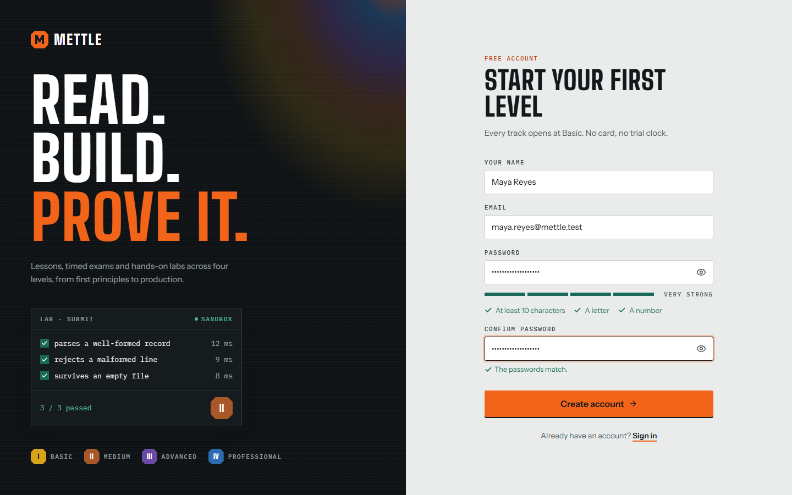

*The checklist under the password ticks off as each rule is met, and the button unlocks when both
passwords match.*

> **Forgot your password?** Use **Forgot your password?** on the sign-in page. You get an email
> with a link that works once and expires after an hour. Choosing a new password signs you out
> everywhere else.

## 2. Tracks, levels and marks

A track is a subject. Each track has up to four levels, and every level is built the same way:
**three lessons, one mock exam, one lab**.

| Level | Name | Mark color |
| --- | --- | --- |
| I | Basic | Straw |
| II | Medium | Bronze |
| III | Advanced | Violet |
| IV | Professional | Blue |

Read the lessons, pass the exam and pass the lab, and the level's mark is stamped on your skill
tree. The colors are the ones steel shows as it is tempered.

Nothing is locked. If you already know the basics, open a higher level and let its exam tell you
whether you were right.

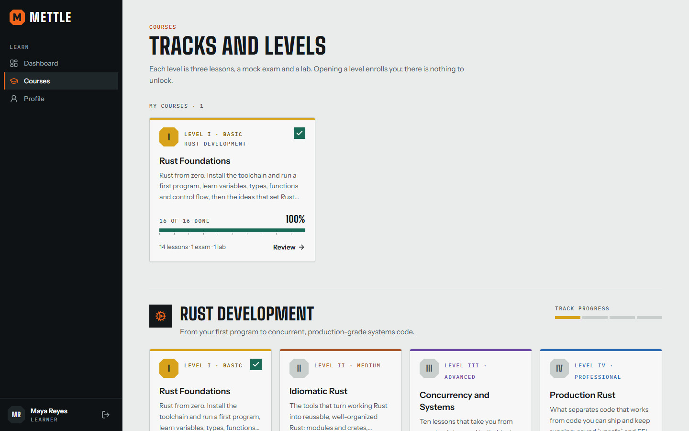

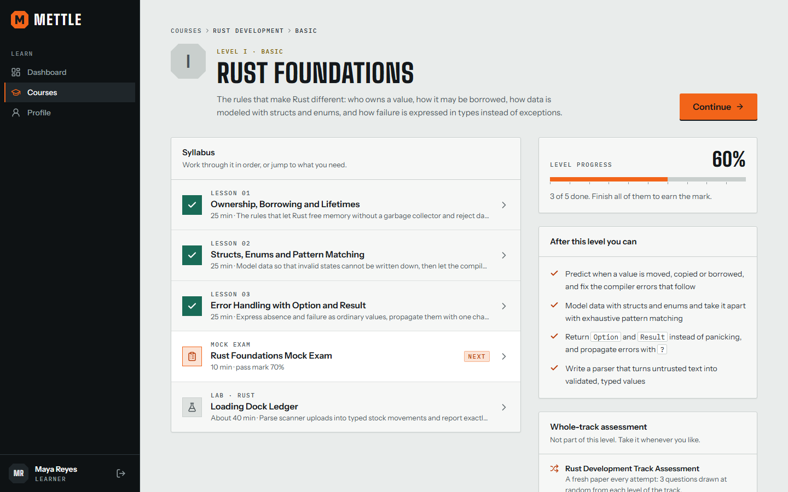

*A level. The syllabus runs in study order and marks the next thing to do.*

## 3. Your dashboard

The dashboard answers one question: what should I do next?

| On the page | What it tells you |
| --- | --- |
| Levels | How many levels you have started, and how many you have completed. |
| Exams passed | Distinct exams with a passing attempt, with your average score across every attempt. |
| Up next | The next unfinished item in each level you are working on. |
| In progress | Your open levels. The gauge counts lessons, the exam and the lab equally. |

## 4. Reading a lesson

Lessons are short and dense: an outline, the sections, working code, and a list of takeaways.
Each one opens with what you should be able to do by the end.

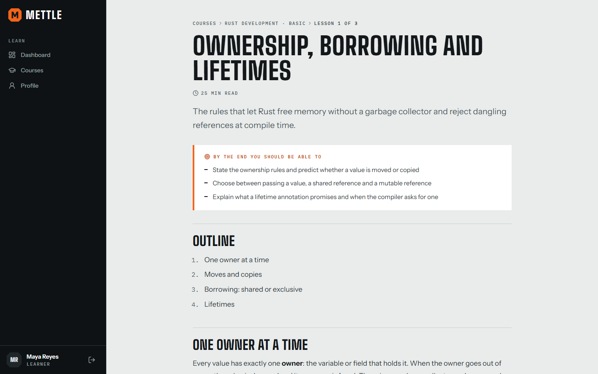

At the end, choose **Mark as read and continue**. The lesson stays readable afterwards.

## 5. Taking a mock exam

A timed, multiple-choice paper. For most exams the questions are drawn from the bank when you
start, so no two attempts are the same.

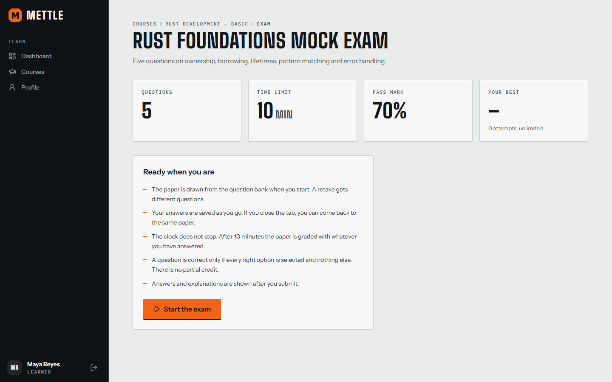

1. **Start.** The clock begins when you press **Start the exam**.
2. **Answer.** Click an option to choose it. Questions that say *Choose all that apply* take
   several. Answers are saved as you go.
3. **Flag** anything you are unsure of, so you can find it in the navigator before you submit.
4. **Submit.** You are told how many questions are blank. After you confirm, answers cannot change.

| Rule | What it means for you |
| --- | --- |
| The clock does not stop | Closing the tab does not pause it. You can return to the same paper while time remains. |
| Time runs out | The paper is graded with what you had answered. Blank questions count as wrong. |
| No partial credit | A "choose all that apply" question is right only when every correct option is chosen and nothing else. |
| Pass mark | Shown before you start, usually 70%. |

Every question is shown again with the right answer marked and an explanation of why. Each graded
paper stays in **Profile → Exam history**.

## 6. Working in a lab

A lab is a realistic task with an editor and a set of tests. Your code is compiled or run for
real, in a sandbox, and the tests decide.

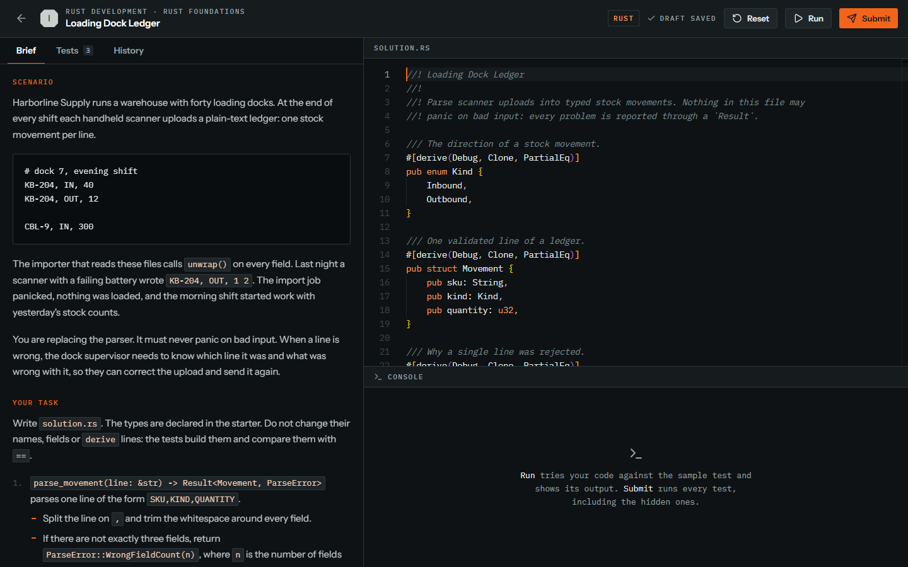

| Tab or button | What it is for |
| --- | --- |
| **Brief** | The scenario, the exact task, and the limits your code runs under. |
| **Tests** | The test cases. A sample test shows its source; hidden tests show only their names. |
| **Files** | Read-only data files placed next to your code, when the lab has any. |
| **History** | Every Run and Submit you have made in this lab. |
| **Run** (`Ctrl` + `Enter`) | Runs the sample test only and shows everything it printed. |
| **Submit** (`Ctrl` + `Shift` + `Enter`) | Runs every test, including the hidden ones. Passing them all completes the lab. |
| **Reset** | Puts the original starter code back. Earlier submissions are kept. |

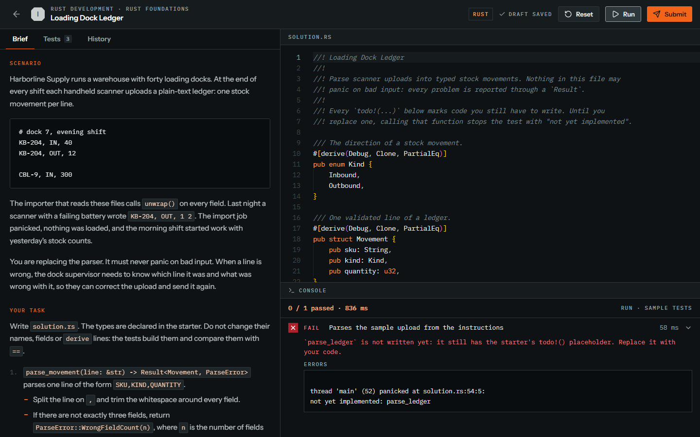

**Reading a hidden test.** When a hidden test fails you see its name, the time it took and one line
saying what it was checking. You do not see its code or the value it expected.

**Your work is saved.** The editor saves a draft a moment after you stop typing.

| The console says | What happened |
| --- | --- |
| Did not build | A compile or syntax error. Nothing was run; the compiler output is shown in full. |
| Timed out | A test ran past its time limit. Look for an infinite loop or a much slower approach than needed. |
| The process was killed | Your code used more memory than the lab allows. |
| The sandbox is busy | Too many people are running code at once. Wait a few seconds and try again. |
| The code exited before the test finished | Your code ended the process itself. Return a value instead. |

Each run gets a new container with no network access, a read-only system, a small scratch folder
and fixed limits on time, memory and processes. Rust labs use the standard library only. Python
labs have NumPy. Shell labs have the usual text tools.

## 7. Your profile and security

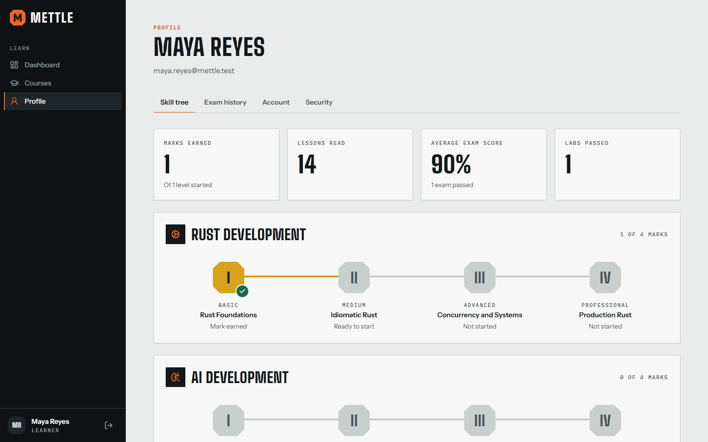

| Tab | What is there |
| --- | --- |
| Skill tree | Every track with its four marks, plus your totals. |
| Exam history | Every graded attempt. Open one to see the paper again. |
| Account | Your name as it appears on the site. |
| Security | Password, two-factor authentication, and the devices signed in to your account. |

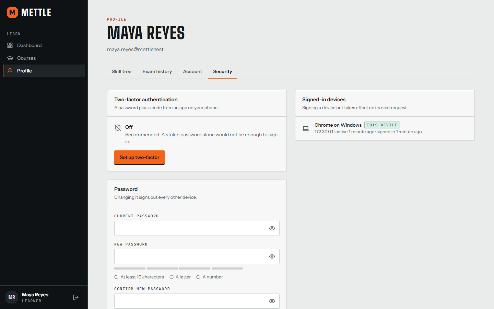

**Turning on two-factor authentication**

1. Open **Profile → Security** and choose **Set up two-factor**.
2. Scan the QR code with an authenticator app, or type the key shown beside it.
3. Enter the 6-digit code the app shows.
4. Save the ten recovery codes. They are shown once, and each works once if you lose your phone.

> **Locked out?** Five wrong passwords in a row lock sign-in for 30 seconds, and the wait doubles
> with each further attempt, up to 15 minutes. Wait it out or reset your password.

## 8. For instructors and administrators

Instructors manage what is taught. Administrators also manage who can sign in.

**First run.** A new installation has no accounts. Opening the site leads to a five-step setup
that asks for a one-time token printed in the server log (`docker compose logs api`), creates the
administrator, turns on two-factor sign-in for them, and names the site.

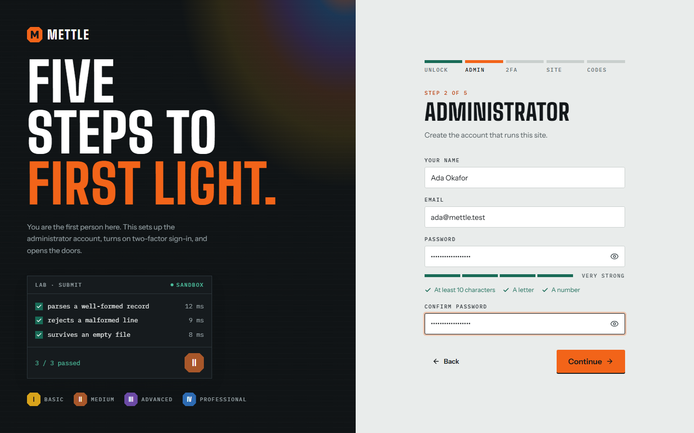

*Overview. Hover a chart for the figures, or switch it to a table.*

*Users. Search, filter and sort happen on the server. Tick rows to email several people at once.*

| Content screen | What you do there |
| --- | --- |
| Tracks & courses | Create a subject and its levels. A new subject needs no code change. |
| Lessons | Write lessons in Markdown with a live preview. |
| Question bank | Add questions one at a time or import them in bulk; filter by track, category, difficulty, type and status. |
| Exams | Build a fixed paper, or a blueprint of rules that draws a new paper for each attempt. |
| Labs | Write the brief, the starter code, the reference solution and the tests, then verify the lab in the sandbox. |

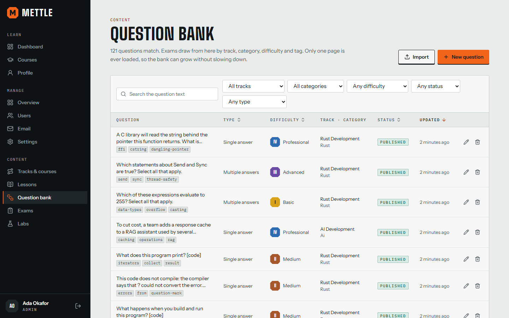

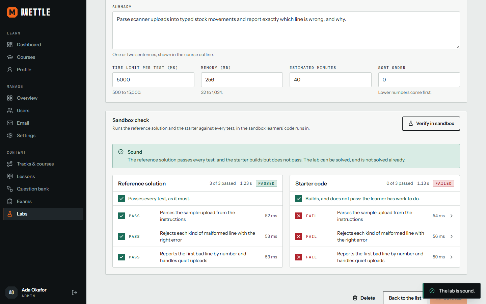

*A lab is sound when its reference solution passes every test and its starter code builds but does
not.*

Learners only ever see **published** content. Keep work in progress as a draft, and archive rather
than delete anything learners have already used.
